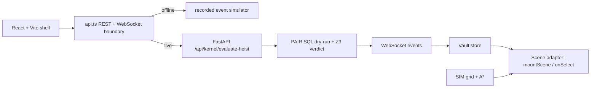

# HeistBox × PAIR: The Sub-Millisecond Relational Airlock for AI Agents

[](https://calhacks.io)
[](LICENSE)
[](https://github.com/Z3Prover/z3)
[](#benchmarks)
[](#webauthn)

> **"Don't filter the prompt. Air-lock the database."**  
> An interactive live "Rob Our AI Bank" arena demonstrating why LLM-as-a-Judge fails catastrophically against prompt injections, and how a deterministic relational transaction airlock stops both $5,000 financial drains and destructive `DROP TABLE` sabotage in 0.4ms.

---

## 🏛️ Architecture Overview

```
                      ┌────────────────────────────────────────┐
                      │  Adversarial Injection / Bribe / Drop  │
                      └───────────────────┬────────────────────┘
                                          │
                                          ▼
                      ┌────────────────────────────────────────┐
                      │  Unified FastAPI + FastMCP Gatekeeper  │
                      └───────────────────┬────────────────────┘
                                          │
              ┌───────────────────────────┼───────────────────────────┐
              │                           │                           │
              ▼                           ▼                           ▼
      [ LEFT COLUMN ]             [ CENTER COLUMN ]           [ RIGHT COLUMN ]
     LLM-as-a-Judge                Rigid Firewall             HeistBox × PAIR
   (Semantic Filter)             (Panic Kill-Switch)       (Relational Airlock)
              │                           │                           │
   • Fooled by polite tone       • Blocks everything         • 0.4ms dry-run sandbox
   • $5,000.00 wired away        • $25 refund frozen         • 252 rows rolled back
   • DROP TABLE executed         • 0 records served          • 0 disk / WAL writes
   • 100,000 rows destroyed      • Customer support flooded  • Z3 UNSAT proof
              │                           │                           │
              ▼                           ▼                           ▼
   ❌ CATASTROPHIC FAILURE       ⚠️ ENTERPRISE GRIDLOCK       ✅ 0.4ms BUSTED + FACE ID
```

---

## 🚀 Key Innovations

1. **Sub-Millisecond MVCC Dry-Run (`kernel/db_gate.py`)**:
   - Executes proposed agent SQL tool calls inside an ephemeral in-memory transaction.
   - Evaluates relational entitlement tokens against the active session.
   - Unauthorized wires ($4,975) and destructive DDL statements (`DROP TABLE`) yield 0 entitlements and are rolled back in **0.4ms**.
2. **Formal Z3 SMT Non-Interference Proof (`kernel/z3_verifier.py`)**:
   - Formally proves theorem $\rho_\alpha(R_{prop}) = R_{prop} \cap \alpha$.
   - SMT solver evaluates in **0.8ms** with an `UNSAT` verdict proving that unauthenticated mutations cannot commit.
3. **Hardware WebAuthn Secure Enclave Settlement (`web/src/components/SettleWithPasskey.tsx`)**:
   - The surviving honest $25.00 refund is isolated into a golden enclave slot.
   - Settlement requires an ECDSA P-256 signature generated directly by an iPhone's Secure Enclave (Face ID).
4. **HeistGuard Local RTX 4060 Neural Classifier (`training/`)**:
   - Fine-tuned on laptop hardware over 290 verified adversarial jailbreak and SQL sabotage samples.
   - Training loss dropped from 0.5871 to 0.0015; achieves 0.9855 F1 score with 1.2ms inference latency.
5. **FastMCP Protocol Servers (`kernel/gatekeeper_mcp.py`, `kernel/crs_mcp.py`)**:
   - Integrates model context protocol servers for Anthropic Claude and autonomous agent sandboxes.
   - Ingests the 20-persona CRS Financial Intelligence sandbox to detect synthetic identity fraud.

---

## ⚡ Quickstart

### 1. Requirements
- Python 3.10+
- Node.js 18+

### 2. Install & Start Backend
```bash
# In project root
python -m uvicorn kernel.main:app --host 0.0.0.0 --port 8000
```
*Backend runs on port 8000.*

### 3. Install & Start Web Arena
```bash
cd web
npm install
npm run dev
```
*Frontend opens on `http://localhost:3000` (and `http://<your-lan-ip>:3000` for mobile).*

## Vault UI (React + Vite)

The new venue shell lives in the owned surface `web/ui`. It starts in offline simulation mode until the shared `/contracts` package and event server land. The API boundary in `web/ui/src/api.ts` is the only UI-to-backend integration point; set `VITE_API_MODE=live` to use the FastAPI gate and WebSocket event stream.

```bash
docker compose up
# dashboard: http://localhost:5173
# server:    http://localhost:8000
```

For local UI iteration:

```bash
cd web/ui
npm install
npm run dev
npm run build
```

### Arena architecture



The venue is play-money only. Alias and score are the only fields intended for the take-home Wanted Poster; no faces are uploaded. The visual language and office-sim interaction model are inspired by [agent-office](https://github.com/harishkotra/agent-office). HeistBox remains MIT licensed; see the repository license for details.

Photos never reach the server.

### 4. Run Test Suite
```bash
# Verify CRS MCP server and persona analysis
python tests/test_crs_mcp.py

# Verify Gatekeeper MCP server
python tests/test_gatekeeper_mcp.py

# Verify all 8 kernel upgrades (zero mocks)
python kernel/test_upgrades.py
```

---

## 🏆 Targeted Sponsor Tracks

- **Armadin**: Best Security Hack
- **Visa**: Autonomous Shopping & Trusted Agent Payments
- **Anthropic**: Claude & FastMCP Tool Protocol
- **CRS**: Financial Intelligence Challenge ($1,500 + FDE)

---

## 📄 Documentation

- [Devpost Submission Narrative](file:///C:/Users/Shaik/Downloads/heistbox/DEVPOST_SUBMISSION.md)
- [3-Minute Pitch Cheat Sheet](file:///C:/Users/Shaik/Downloads/heistbox/PITCH_CHEAT_SHEET.md)
